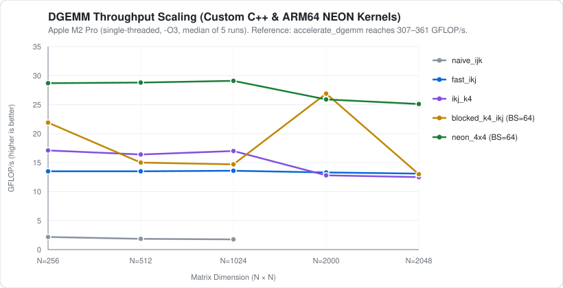
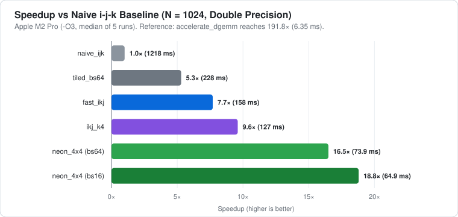
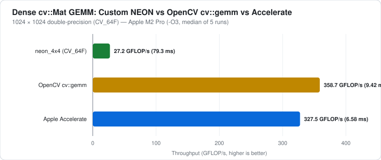
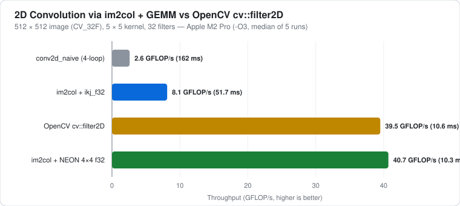

## Fast Matrix Multiplication in C++20, Compared with OpenCV

A study of dense double-precision matrix multiplication (`C = A × B`) on Apple Silicon, written in C++20 with Google Benchmark. It starts from a naive `i-j-k` triple loop and works through loop interchange, cache blocking, flat row-major storage, `k`-loop unrolling, and a hand-written ARM64 NEON 4×4 micro-kernel with a packed `B` panel, then measures each step against Apple Accelerate (`cblas_dgemm`). A built-in `--verify` mode checks every kernel against a plain reference.

The same kernels are also compared with the OpenCV library on `cv::Mat` data, in an optional target that is built when OpenCV 4 is installed. Three workloads are measured, each implemented both ways:

- **Dense matrix product:** the NEON kernel against `cv::gemm`, which is about 8× faster at `N = 1024`.
- **2D convolution (32 filters, 5×5):** `im2col` followed by the NEON kernel against `cv::filter2D`, which run at the same speed.
- **Per-pixel color transform (3×3):** a small matrix product against `cv::transform`, where the hand-written version is 4.2× faster.

Details are in [OpenCV Integration](#5-opencv-integration-cvgemm--2d-convolution-im2col--gemm).

## Key Results at a Glance

Median execution time and throughput (`1 FMA = 2 FLOPs`, so `GFLOP/s = 2·N³ / t`) on **Apple M2 Pro** (single-threaded, `-O3`):

| Variant                   | Technique                             |        N = 1024 Time | N = 1024 GFLOP/s |        N = 2048 Time | N = 2048 GFLOP/s | Speedup vs `naive_ijk` (N = 1024) |
| :------------------------ | :------------------------------------ | -------------------: | ---------------: | -------------------: | ---------------: | --------------------------------: |
| `naive_ijk`               | `i-j-k`, `double**`                   |              1218 ms |             1.76 |           28,399 ms* |            0.60* |                              1.0× |
| `tiled_bs64`              | `ii-kk-jj`, `double**`                |               228 ms |             9.42 |                    — |                — |                              5.3× |
| `blocked_bs64`            | `si-sk-sj`, flat `double*`            |               222 ms |             9.67 |                    — |                — |                              5.5× |
| `fast_ikj`                | `i-k-j`, `double**`                   |               158 ms |             13.6 |              1316 ms |             13.1 |                              7.7× |
| `blocked_k4_ikj_bs64`     | `ii-kk-jj` + `k×4` unroll             |               146 ms |             14.7 |              1319 ms |             13.0 |                              8.3× |
| `ikj_k4`                  | `i-k-j` + `k×4` unroll (no blocks)    |               127 ms |             16.9 |              1377 ms |             12.5 |                              9.6× |
| `neon_4x4_bs64`           | 4×4 NEON FMA + packed B               |          **73.9 ms** |         **29.1** |           **702 ms** |         **25.1** |                         **16.5×** |
| `neon_4x4_bs16` / `bs256` | Best `neon_4x4` per size              | **64.9 ms** (`bs16`) |         **33.1** | **645 ms** (`bs256`) |         **26.6** |                         **18.8×** |
| `accelerate_dgemm`        | Apple Accelerate (`VECLIB_THREADS=1`) |          **6.35 ms** |        **339.5** |          **56.1 ms** |        **307.1** |                        **191.8×** |

*\*`naive_ijk` at N = 2048 was measured in an earlier `-O2` run; not re-run in the `-O3` suite.*

### Core Findings

- *Loop interchange (`i-j-k` → `i-k-j`)** yields a **6.2–7.8×** speedup up to `N = 1024` by turning column-strided reads of `B` into sequential row streams.
- *Cache blocking alone does not beat `fast_ikj`:** every plain blocked variant (`tiled`, `blocked`, `tiled_flat`, `tiled_flat_v2`) is slower than plain `i-k-j` whenever `BS < N`.
- *Unrolling `k` by 4 (`ikj_k4`)** cuts `C` load/store traffic by 4× and improves speed by **15–25%** up to `N = 1024` without any blocking.
- *Blocking + `k`-unrolling (`blocked_k4_ikj`)** reaches **2×** speedup over `fast_ikj` on non-power-of-two sizes (`N = 500, 1000, 2000`), but suffers severe **cache-set conflict penalties** at power-of-two sizes (`N = 1024, 2048`) when `BS ≤ 64`.
- *A 4×4 ARM64 NEON micro-kernel with packed `B` (`neon_4x4`)** delivers a consistent **~2×** speedup over `fast_ikj` across all tested sizes and eliminates power-of-two sensitivity for `BS ≥ 32`.
- *Apple Accelerate (`cblas_dgemm`)** is another **10–12×** faster than `neon_4x4` (~340 GFLOP/s single-threaded), likely leveraging Apple Silicon matrix coprocessor (AMX) hardware.





---

## Test Environment & Methodology

- *CPU:** Apple M2 Pro (12 cores; L1 Data: 64 KiB, L1 Instruction: 128 KiB, L2 Unified: 4 MiB)
- *Compiler & Flags:** C++20, `-O3 -Wall -Wextra` (`RelWithDebInfo`)
- *Benchmarking:** Google Benchmark v1.9.5, 5 repetitions per configuration (`median` reported), `caffeinate -i` and `VECLIB_MAXIMUM_THREADS=1`
- *Verification:** Every kernel is checked against `bad_matrix_multiply` before and after benchmarking, plus standalone `--verify` mode (`216/216` checks pass across all 6 block sizes)


## Implemented Variants

| Benchmark Name       | Function                           | Storage        | Outer Block Order   | Inner Strategy                        |
| :------------------- | :--------------------------------- | :------------- | :------------------ | :------------------------------------ |
| `naive_ijk`          | `bad_matrix_multiply`              | `double**`     | none (`i-j-k`)      | Scalar dot product                    |
| `fast_ikj`           | `fast_matrix_multiply`             | `double**`     | none (`i-k-j`)      | Sequential row streaming              |
| `tiled_bs*`          | `matmul_tiled`                     | `double**`     | `ii-kk-jj`          | `i-k-j` inside `BS×BS×BS`             |
| `tiled_flat_bs*`     | `matmul_tiled_flat`                | flat `double*` | `ii-kk-jj`          | `i-k-j` (runtime `BS`)                |
| `tiled_flat_v2_bs*`  | `matmul_tiled_flat_v2`             | flat `double*` | `ii-jj-kk`          | `i-k-j`                               |
| `blocked_bs*`        | `blocked_matrix_multiply`          | flat `double*` | `si-sk-sj`          | `i-k-j` (compile-time `BS`)           |
| `ikj_k4`             | `ikj_k4_matrix_multiply`           | flat `double*` | none (`i-k-j`)      | 4 rows of `B` per pass                |
| `blocked_k4_bs*`     | `blocked_k4_matrix_multiply`       | flat `double*` | `sj-si-sk`          | 4 rows of `B` per pass                |
| `blocked_k4_ikj_bs*` | `blocked_k4_ikj_matrix_multiply`   | flat `double*` | `ii-kk-jj`          | 4 rows of `B` per pass                |
| `blocked_k8_bs*`     | `blocked_matrix_multiply_k8`       | flat `double*` | `si-sj-sk`          | 8 rows of `B` per pass                |
| `neon_4x4_bs*`       | `neon_4x4_matrix_multiply`         | flat `double*` | `jj-kk`, packed `B` | 4×4 NEON FMA micro-kernel             |
| `accelerate_dgemm`   | `accelerate_dgemm_matrix_multiply` | flat `double*` | Apple Accelerate    | `cblas_dgemm`                         |
| `gemm_sub_tiled_bs*` | `gemm_sub_tiled`                   | flat `double*` | `ii-pp-jj`          | LU trailing update (`A22 -= L21×U12`) |

---

## Detailed Experiments

### 1. Loop Interchange (`i-j-k` vs `i-k-j`)

| Metric                |  N = 256 |  N = 500 |  N = 512 | N = 1000 | N = 1024 |
| :-------------------- | -------: | -------: | -------: | -------: | -------: |
| `naive_ijk` (ms)      |     15.4 |      133 |      144 |     1137 |     1218 |
| `fast_ikj` (ms)       |     2.48 |     18.2 |     19.4 |      147 |      157 |
| **Speedup**           | **6.2×** | **7.3×** | **7.4×** | **7.7×** | **7.8×** |
| `naive_ijk` (ns / N³) |    0.918 |    1.064 |    1.073 |    1.137 |    1.134 |
| `fast_ikj` (ns / N³)  |    0.148 |    0.146 |    0.145 |    0.147 |    0.146 |

Plain `i-k-j` maintains a constant ~0.147 ns per multiply-add all the way to `N = 2048` (0.148 ns), even when `B` reaches 32 MiB and exceeds L2 cache, because sequential row streams are handled effectively by the hardware prefetcher.

---

### 2. Cache Blocking Alone & Storage Layout (`double**` vs Flat `double*`)

Four single-row-of-`B` blocked variants at `N = 1024` (time in ms, vs `fast_ikj` = 157 ms):

|  BS | `tiled` (`double**`) | `blocked` (flat) | `tiled_flat` | `tiled_flat_v2` | Slowdown vs `fast_ikj` |
| --: | -------------------: | ---------------: | -----------: | --------------: | :--------------------- |
|  16 |                  322 |              312 |          312 |             350 | 2.0–2.2×               |
|  32 |                  292 |              270 |          270 |             268 | 1.7–1.9×               |
|  64 |                  228 |              222 |          224 |             221 | 1.4–1.5×               |
| 128 |                  206 |              204 |          205 |             209 | 1.3×                   |
| 256 |                  201 |              197 |          202 |             204 | 1.3×                   |
| 512 |                  187 |              186 |          184 |             189 | 1.2×                   |

Flat row-major storage (`blocked`) beats pointer-of-pointers (`tiled`) in 17 of 18 `(BS, N)` combinations by up to 8%, removing one pointer indirection per row. However, **no plain blocked variant beats `fast_ikj` when `BS < N`**, because `fast_ikj` is already compute/stream-balanced and blocking shortens the inner sequential memory streams without reducing `C` load/store traffic.

---

### 3. `k`-Unrolling, Power-of-Two Conflicts, and ARM64 NEON (`neon_4x4`)

Median times in ms (percentages relative to `fast_ikj` at the same `N`):

| Variant                    |     N = 256 |     N = 512 |    N = 1024 |    N = 2000 |    N = 2048 |
| :------------------------- | ----------: | ----------: | ----------: | ----------: | ----------: |
| `fast_ikj`                 |   2.44–2.54 |   19.3–19.9 |     156–167 |   1167–1233 |   1251–1316 |
| `ikj_k4` (no blocks)       | 1.95 (−21%) | 16.5 (−15%) |  125 (−20%) |  1260 (+5%) | 1393 (+10%) |
| `blocked_k4_ikj`, BS = 16  | 1.73 (−30%) | 15.1 (−22%) |   167 (+6%) |  839 (−30%) | 1781 (+40%) |
| `blocked_k4_ikj`, BS = 32  | 1.33 (−46%) | 16.7 (−14%) |   166 (+6%) |  608 (−49%) | 1466 (+15%) |
| `blocked_k4_ikj`, BS = 64  | 1.53 (−38%) |  17.9 (−8%) |   146 (−7%) |  595 (−50%) |  1319 (+4%) |
| `blocked_k4_ikj`, BS = 128 | 2.14 (−14%) |  18.1 (−7%) |   152 (−3%) | 1065 (−11%) |   1271 (0%) |
| `blocked_k4_ikj`, BS = 256 | 1.95 (−21%) | 16.7 (−14%) |  137 (−13%) | 1004 (−16%) |  1172 (−8%) |
| `blocked_k4_ikj`, BS = 512 | 1.95 (−21%) | 16.5 (−15%) |  129 (−18%) |  947 (−21%) | 1088 (−14%) |
| `neon_4x4`, BS = 16        | 0.99 (−60%) | 8.35 (−57%) | 64.9 (−59%) |  795 (−34%) |  1353 (+6%) |
| `neon_4x4`, BS = 32        | 1.14 (−54%) | 8.92 (−54%) | 72.6 (−54%) |  722 (−40%) |  840 (−34%) |
| `neon_4x4`, BS = 64        | 1.17 (−53%) | 9.33 (−52%) | 73.9 (−53%) |  618 (−49%) |  702 (−45%) |
| `neon_4x4`, BS = 128       | 1.24 (−50%) | 9.88 (−49%) | 80.4 (−49%) |  603 (−50%) |  652 (−49%) |
| `neon_4x4`, BS = 256       | 1.27 (−49%) | 10.0 (−48%) | 80.2 (−49%) |  599 (−50%) |  645 (−49%) |
| `neon_4x4`, BS = 512       | 1.28 (−48%) | 10.1 (−48%) | 80.9 (−48%) |  603 (−50%) |  650 (−49%) |
| `accelerate_dgemm`         |       0.094 |       0.773 |        6.35 |        49.0 |        56.1 |

#### Power-of-Two Sensitivity Check

Normalized cost per operation ratio (`time_ratio / N³_ratio`, where `1.00×` = identical cost per op):

| Variant                   | N = 500 (ms) | N = 1000 (ms) | 512 vs 500 | 1024 vs 1000 | 2048 vs 2000 |
| :------------------------ | -----------: | ------------: | ---------: | -----------: | -----------: |
| `fast_ikj`                |    18.2–18.8 |       146–152 |      0.99× |        0.99× |        0.99× |
| `ikj_k4`                  |  13.7 (−25%) |    111 (−24%) |      1.12× |        1.05× |        1.03× |
| `blocked_k4_ikj`, BS = 32 |  9.34 (−49%) |   74.1 (−50%) |      1.67× |        2.09× |        2.25× |
| `blocked_k4_ikj`, BS = 64 |  8.90 (−51%) |   70.1 (−52%) |      1.87× |        1.94× |        2.06× |
| `neon_4x4`, BS = 64       |  8.50 (−53%) |   68.5 (−53%) |      1.02× |        1.00× |        1.06× |
| `neon_4x4`, BS = 256      |  9.27 (−49%) |   74.3 (−49%) |      1.00× |        1.01× |        1.00× |
| `accelerate_dgemm`        |        0.698 |          5.88 |      1.03× |        1.01× |        1.07× |

- `blocked_k4_ikj` with `BS ≤ 64` slows down by **1.6–2.3× per operation** on power-of-two dimensions (`512, 1024, 2048`), consistent with L1 cache-set aliasing (at `N = 2048`, one row is `16 KiB`, matching one L1 cache way).
- `neon_4x4` packs each `B` tile into a contiguous buffer, removing row-stride aliasing and keeping the power-of-two ratio at **1.00–1.08×** for `BS ≥ 32`.

---

### 4. Other `k`-Unrolled & LU Trailing Update Variants (`N = 1024`, ms)

|  BS | `blocked_k4` (`sj-si-sk`) | `blocked_k4_ikj` (`ii-kk-jj`) | `blocked_k8` (`si-sj-sk`) | `gemm_sub_tiled` |
| --: | ------------------------: | ----------------------------: | ------------------------: | ---------------: |
|  16 |                       185 |                           167 |                       213 |              337 |
|  32 |                       168 |                           166 |                       176 |              249 |
|  64 |                       151 |                           146 |                       153 |              201 |
| 128 |                       150 |                           152 |                       142 |              199 |
| 256 |                       137 |                           137 |                       132 |              196 |
| 512 |                       130 |                           129 |                       133 |              190 |

- Unrolling `k` by 8 (`blocked_k8`) does not improve on `k = 4` (within 7% for `BS ≥ 32`, 28% slower at `BS = 16`).
- `gemm_sub_tiled` implements the in-place LU trailing update `A22 -= L21 × U12` (`N × N` sub-problem).

---

### 5. OpenCV Integration: `cv::gemm` & 2D Convolution (`im2col + GEMM`)

When OpenCV is available (`find_package(OpenCV QUIET)`), the optional `matmul-opencv` target bridges dense matrix multiplication to real computer-vision workloads on `cv::Mat`:

1. **Dense `CV_64F` `cv::Mat` `GEMM` vs `cv::gemm`:**

| Variant                 | N = 256 (ms / GFLOP/s) | N = 512 (ms / GFLOP/s) | N = 1024 (ms / GFLOP/s) |
| :---------------------- | ---------------------: | ---------------------: | ----------------------: |
| `neon_4x4_cv_mat_f64`   |         1.19 ms / 28.3 |         9.57 ms / 28.1 |          79.3 ms / 27.2 |
| `cv::gemm` (`CV_64F`)   |       0.292 ms / 216.0 |        1.26 ms / 361.4 |         9.42 ms / 358.7 |
| `accelerate_cv_mat_f64` |       0.092 ms / 363.6 |       0.764 ms / 351.5 |         6.58 ms / 327.5 |



2. **Multi-Filter 2D Convolution (`5×5` kernel, 32 filters, `CV_32F`) via `im2col + GEMM`:**
   Each `5×5` image patch is unrolled into a `(H·W) × 25` matrix and multiplied by a `25 × 32` filter bank using rectangular `float32` `GEMM` (`M × K × N`), verified against `cv::filter2D` (`max_abs_diff < 1e-4`):

| Implementation                    | 256×256 (ms / GFLOP/s) | 512×512 (ms / GFLOP/s) | Speedup vs Naive (512×512) |
| :-------------------------------- | ---------------------: | ---------------------: | -------------------------: |
| `conv2d_naive` (4-loop)           |         40.9 ms / 2.58 |          162 ms / 2.60 |                       1.0× |
| `im2col + ikj_f32`                |         12.9 ms / 8.15 |         51.7 ms / 8.13 |                       3.1× |
| `OpenCV cv::filter2D` (32 passes) |         2.76 ms / 38.1 |         10.6 ms / 39.5 |                      15.3× |
| `im2col + NEON 4×4 f32`           |     **2.53 ms / 41.6** |     **10.3 ms / 40.7** |                  **15.7×** |



3. **Pixel Color Matrix Transform (`(H·W) × 3` multiplied by `3 × 3`, `CV_32FC3`) vs `cv::transform`:**
   Applying a `3×3` sepia color matrix per pixel, verified against `cv::transform` (`max_abs_diff < 1e-4`):

| Implementation             | 256×256 (ms / GFLOP/s) | 512×512 (ms / GFLOP/s) | 1024×1024 (ms / GFLOP/s) | Speedup vs `cv::transform` |
| :------------------------- | ---------------------: | ---------------------: | -----------------------: | -------------------------: |
| `OpenCV cv::transform`     |        0.078 ms / 15.1 |        0.312 ms / 15.2 |           1.31 ms / 14.4 |                       1.0× |
| `color_transform_gemm_f32` |    **0.019 ms / 62.5** |    **0.077 ms / 61.0** |      **0.314 ms / 60.2** |                   **4.2×** |

---

### Limitations & Notes

- **Hardware counters:** L1/LL cache-miss and TLB-miss counters were not collected; the L1 set-aliasing explanation for power-of-two strides is inferred from the size pattern rather than directly measured.
- **Accelerate baseline:** `accelerate_dgemm` achieves ~170B multiply-adds/s (~340 GFLOP/s) on a single thread (`VECLIB_MAXIMUM_THREADS=1`), which exceeds standard NEON throughput and likely reflects Apple AMX usage. With 8 threads (`VECLIB_MAXIMUM_THREADS=8`), it reaches 3.46 ms at `N = 1024` (another ~1.9× faster).
- **Run-to-run variance:** Most benchmarks have `CV < 3%`, except `ikj_k4` (up to 15–20% in some runs), `neon_4x4_bs16` at `N = 2000` (12%), and `accelerate_dgemm` (4–7%). Small single-digit percentage differences should not be over-interpreted.
- **Portability:** `neon_4x4` and `accelerate_dgemm` target Apple Silicon / ARM64; x86_64 builds require guarding or disabling those targets.

---

### Build, Verify & Run

```sh
# Configure and build all block-size executables (BS = 16, 32, 64, 128, 256, 512)
cmake -S . -B build
cmake --build build -j 8

# Run correctness verification across all variants and block sizes (216 checks)
cmake --build build --target verify-all

# Run benchmarks
cmake --build build --target run-bs64                          # BS = 64 only
cmake --build build --target run-all                           # All block sizes
cmake --build build --target run-bs64 -DFILTER="neon|accel"    # Filter by regex
cmake --build build --target run-opencv                        # Optional OpenCV + im2col suite
```

Direct binary usage:

```sh
./build/matmul-bs64 --verify
./build/matmul-bs64 --benchmark_filter="fast_ikj|neon_4x4|accelerate_dgemm"
```
